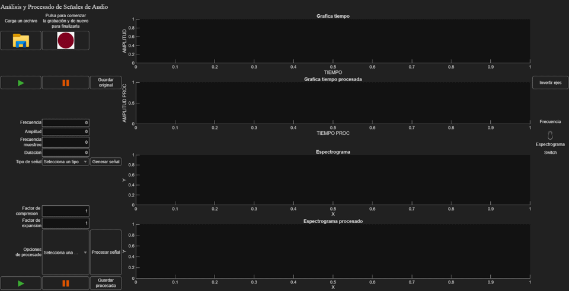
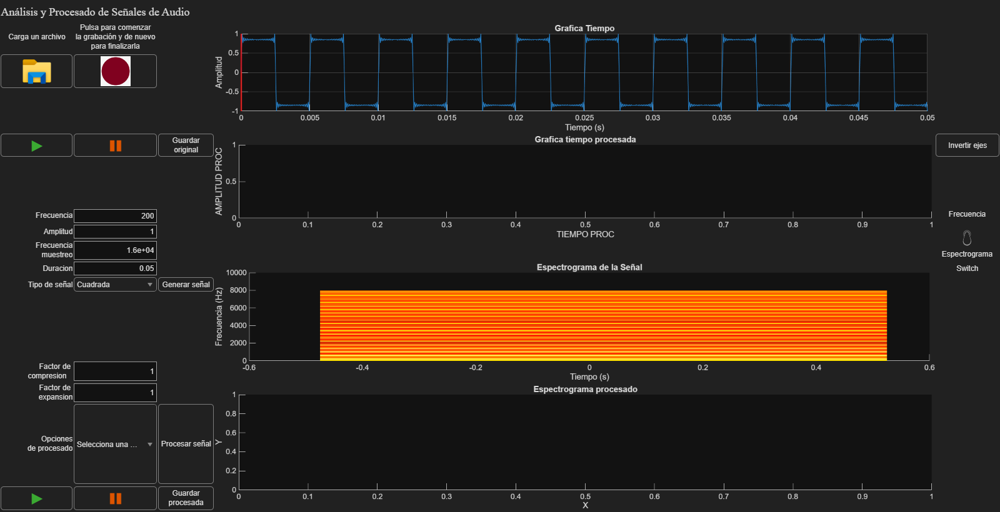
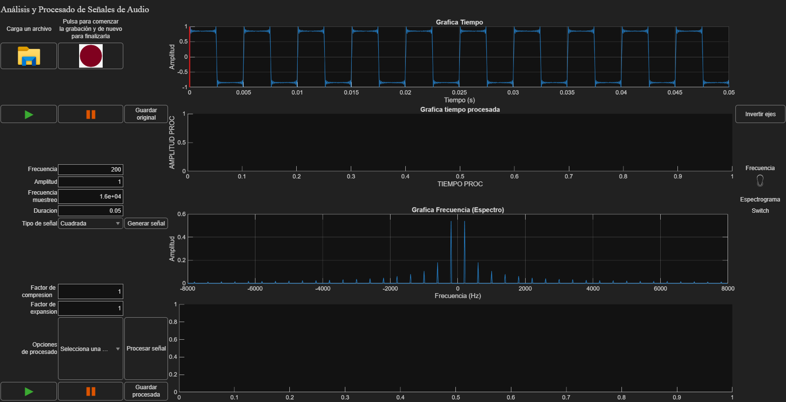
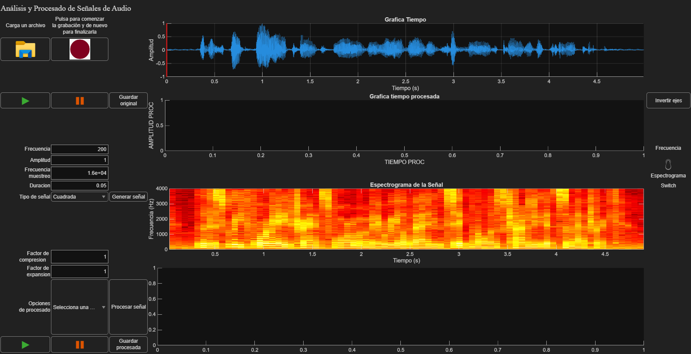
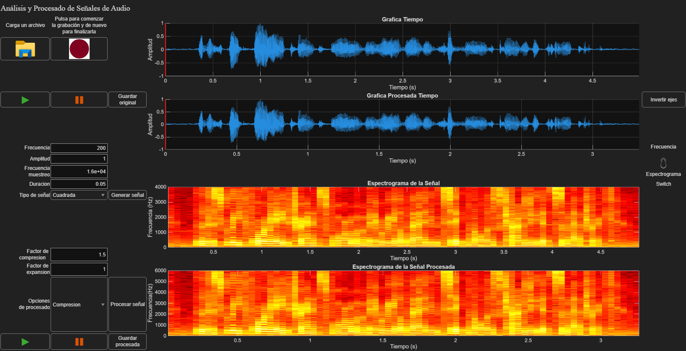

# Audio Signal Analysis & Processing App (MATLAB)

A desktop app built with **MATLAB App Designer** to record, load or synthesise audio signals, look at them in the time and frequency domains, change their time scale and play them back.

Course project for *Fundamentals of Sound and Image*, B.Sc. in Telecommunication Technologies Engineering, University of Valladolid (autumn 2025).
Authors: **Víctor Merino de la Calle** and **Ana Santiago Prieto**.



*The demo runs the real app without anyone touching it (see [`demo/make_demo.m`](demo/make_demo.m)): it synthesises a 200 Hz square wave, switches to its spectrum, loads a speech recording and compresses it in time by 1.5×.*

## Features

| Area | What it does |
|---|---|
| **Input** | Load `.wav` / `.mp3` / `.wma` files (stereo is converted to mono), record from the microphone, or generate sine, cosine, square, triangle and sawtooth waves |
| **Signal synthesis** | Square and sawtooth waves are built by **additive Fourier synthesis** (sum of 1/k harmonics) and normalised to the requested amplitude. Parameters are validated, and the app warns about **aliasing** when the frequency is above Fs/2 |
| **Analysis** | Time-domain waveform plus either a **spectrogram** (Hamming window, 1024-point FFT, 50 % overlap) or the **two-sided magnitude spectrum** (FFT), for the original and the processed signal side by side |
| **Processing** | Time **compression**, **expansion** or both, by any factor. The factor is turned into a rational P/Q with `rat` and applied to the playback sample rate, so the signal is shorter or longer and its pitch moves up or down |
| **Playback** | Play/pause for each signal with a **cursor that follows the audio** in real time (a MATLAB `timer` every 100 ms), plus **reverse mode**, which flips the time axes and plays the audio backwards |
| **Export** | Save the original or the processed signal as a WAV file |

## Screenshots

| Square wave from 20 odd harmonics | Its spectrum: odd harmonics with 1/k amplitude |
|---|---|
|  |  |
| **Speech recording: waveform and spectrogram** | **Speech compressed ×1.5: shorter, with a higher spectrum** |
|  |  |

## Run it

Requirements: MATLAB **R2025b** (the release it was saved with) with the **Signal Processing Toolbox** (`spectrogram`, `sawtooth`).

```matlab
cd app
InterfazGrafSonido          % or double-click InterfazGrafSonido.mlapp
```

To regenerate the screenshots and the GIF (no clicking needed):

```bash
matlab -batch "addpath('demo'); make_demo"
```

`make_demo` presses the app's buttons from code. For the *Load* button it puts [`demo/shim/uigetfile.m`](demo/shim/uigetfile.m) first on the path, so the file dialog returns a speech sample that ships with MATLAB instead of waiting for the user.

## Repository layout

```
app/    InterfazGrafSonido.mlapp + button icons (what you open in MATLAB)
code/   the same app as a plain .m class, so the code can be read on GitHub
demo/   make_demo.m, the uigetfile shim, screenshots and demo.gif
docs/   programming report and user manual (in Spanish, as submitted)
```

## What I learned

- How to structure a GUI app around callbacks and shared state: original and processed signals, players, recording object and timer.
- Spectral analysis in practice: windowing, overlap and FFT size for spectrograms, the two-sided spectrum and the Nyquist limit.
- Fourier synthesis of non-sinusoidal waveforms, and why a band-limited square wave shows ripple (the Gibbs phenomenon).
- Time scaling by changing the sample rate, and how it shifts the spectrum.

The UI and comments are in Spanish, because it was a Spanish-language course.
